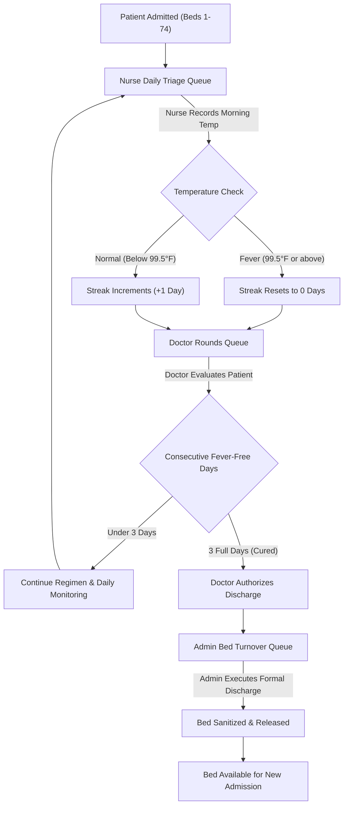

# 🏥 QuarantineCare — Virus Quarantine & Treatment Facility Portal

<div align="center">

[](https://quarantinecare-live.vercel.app/)
[](https://react.dev/)
[](https://vitejs.dev/)
[](https://developer.mozilla.org/en-US/docs/Web/JavaScript)
[](https://developer.mozilla.org/en-US/docs/Web/CSS)

### **Technical Product Manager (TPM) Assessment Solution**
**Author:** Pranjal Singh (23-ITC27-27)  
**Evaluation Target:** FactWise Assessment  
**Live URL:** [https://quarantinecare-live.vercel.app](https://quarantinecare-live.vercel.app)

</div>

---

## 📌 Executive Summary

**QuarantineCare** is an operations and clinical workflow management platform designed for a high-density virus quarantine and treatment centre operating at **100% capacity (74 rooms/beds)**.

The virus has an expected **15% mortality rate** (target recovery rate: **85%**), characterized by prolonged fever. Clinical guidelines dictate that a patient is considered cured solely upon completing **3 consecutive full calendar days without a fever** (< 99.5°F / 37.5°C).

### Core Operational Inefficiencies Resolved:
1. **Paper Journal Desynchronization:** Replaces manual journals with real-time digital tracking.
2. **Double / Missed Measurements:** Real-time morning queue ensures every patient is checked exactly once daily with duplicate guards.
3. **Sequential Workflow Inversion:** Eliminates wasted doctor visits by enforcing that doctors only evaluate patients whose morning temperatures have already been taken by nurses.
4. **Bed Turnover Latency:** Discharges are authorized via doctor sign-off and immediately flagged to administrative staff to prevent patients staying 1–2 extra days unnecessarily.
5. **Quality Benchmarking:** Dynamic calculation of closed-case mortality and recovery rates against the 15% mortality / 85% success benchmark.

---

## 🔄 Clinical Workflow & System Architecture



---

## 🛠️ Technology Stack

| Layer | Technologies & Tools |
|:---|:---|
| **Core Framework** | React 19 (Functional Components, Custom Hooks, Reactive State) |
| **Bundler & Tooling** | Vite 6 (Fast HMR, Tree-shaking, Optimized ES Modules) |
| **Design & UI** | Custom Vanilla CSS (Glassmorphism, CSS Grid, Accessible High-Contrast Theme) |
| **Icons** | Lucide React (Clinical, status, and navigation iconography) |
| **Deployment** | Vercel (Edge-cached static hosting with automatic CI/CD) |
| **Simulation** | Interactive Multi-Day Engine for testing 3-day fever-free state transitions |

---

## 🌟 Key Application Modules

### 1. 📊 Executive Facility Dashboard
* **Bed Capacity Dial:** Real-time occupancy tracking (Active / 74 Beds).
* **Morning Compliance Progress:** Live percentage and pending counts for Nurse Temperature Checks.
* **Doctor Compliance Progress:** Live tracking of completed vs pending physician rounds.
* **Quality Benchmark Monitor:** Real-time closed-case mortality rate tracking against the **15.0% benchmark** and **85.0% success target**.

### 2. 🛏️ 74-Bed Interactive Ward Matrix
* Real-time grid representing all **74 rooms**.
* Search by Room Number or Patient Name.
* Dynamic filter chips: *All Rooms*, *Awaiting Nurse*, *Ready for Doctor*, *3-Day Cured / Ready for Discharge*, and *High Fever Alert*.

### 3. 🌡️ Nurse Morning Triage Station
* Auto-populating queue of patients awaiting morning vitals.
* 1-click rapid presets (`98.4°F`, `98.6°F`, `99.8°F`, `101.5°F`) and custom temperature logger.
* Duplicate protection guard with confirmation prompts.
* Automatic fever classification (< 99.5°F Normal vs $\ge$ 99.5°F Fever).

### 4. 🩺 Doctor Clinical Rounds Station
* Enforces clinical sequencing: only patients with recorded temperatures appear as "Ready for Round".
* Real-time **3-day fever-free streak tracker** ($0/3$, $1/3$, $2/3$, $3/3$).
* Locked discharge recommendation button: enabled strictly when the 3-day no-fever criterion is met.
* Treatment notes, prescription management, and clinical outcome recording.

### 5. 🏢 Administration & Bed Turnover Desk
* Immediate queue of doctor-recommended discharges.
* 1-click formal discharge: frees room and clears bed for sanitization.
* Patient admission modal: enforces maximum 74-bed capacity guard.

### 6. ⏱️ Quarantine Simulation Engine
* **"Simulate Next Day (+1)"** button: advances facility calendar day, archives previous day's vitals, and tests multi-day fever-free streak progression.
* **"Reset Simulation"** button: restores default scenario.

---

## 💻 Local Setup & Execution

```bash
# 1. Clone repository
git clone https://github.com/prancodes/Factwise-Assessment-TPM.git

# 2. Navigate to directory
cd Factwise-Assessment-TPM

# 3. Install dependencies
npm install

# 4. Start local development server
npm run dev
```

Build for production:
```bash
npm run build
```

---

## 🌐 Live Platform

* **Production URL:** [https://quarantinecare-live.vercel.app](https://quarantinecare-live.vercel.app)
* **GitHub Repository:** [https://github.com/prancodes/Factwise-Assessment-TPM](https://github.com/prancodes/Factwise-Assessment-TPM)
* **Author:** Pranjal Singh (23-ITC27-27)
